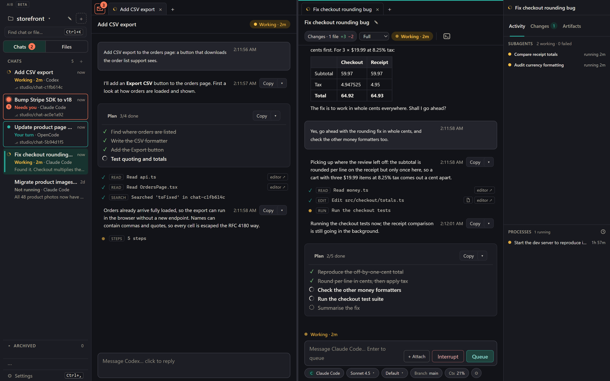
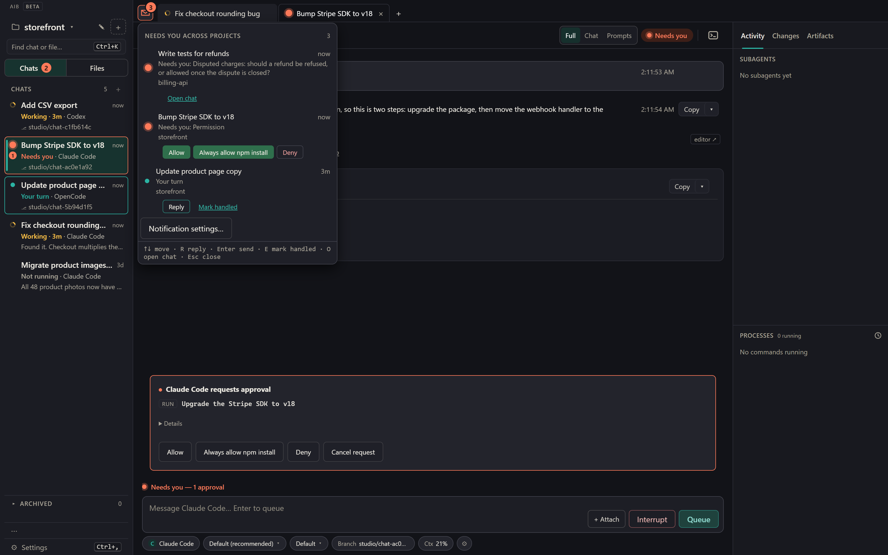
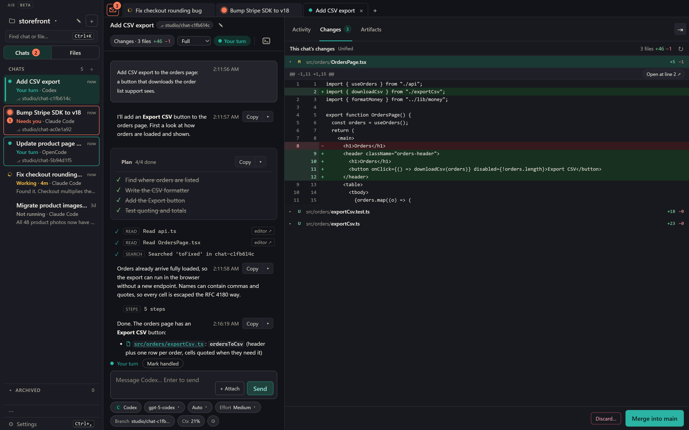
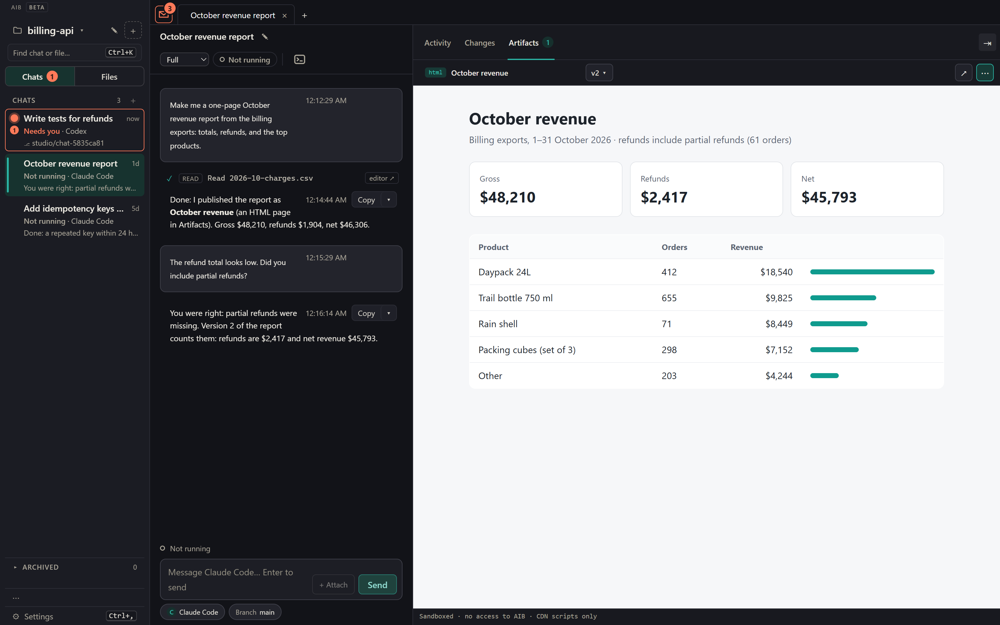
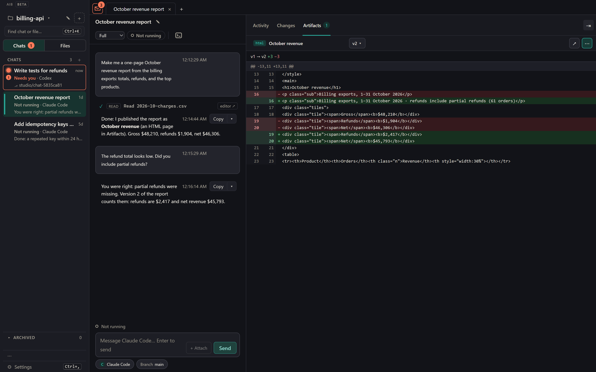
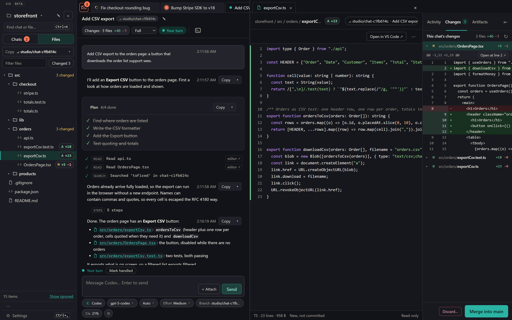
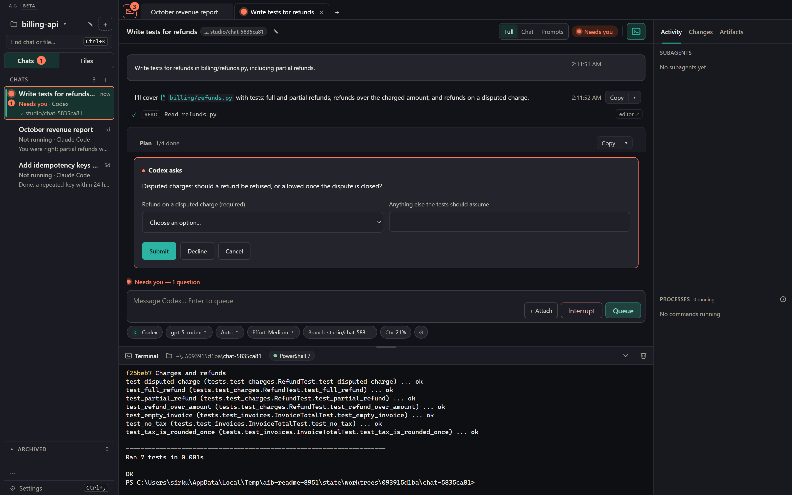
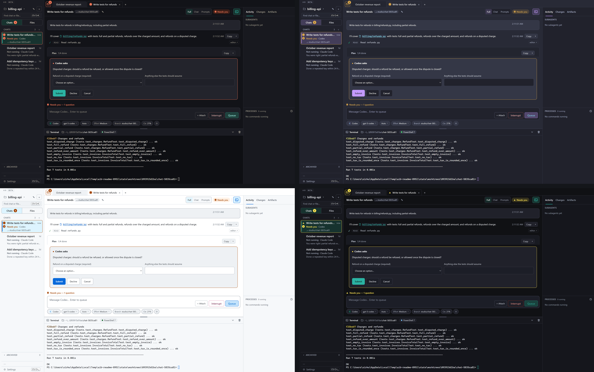
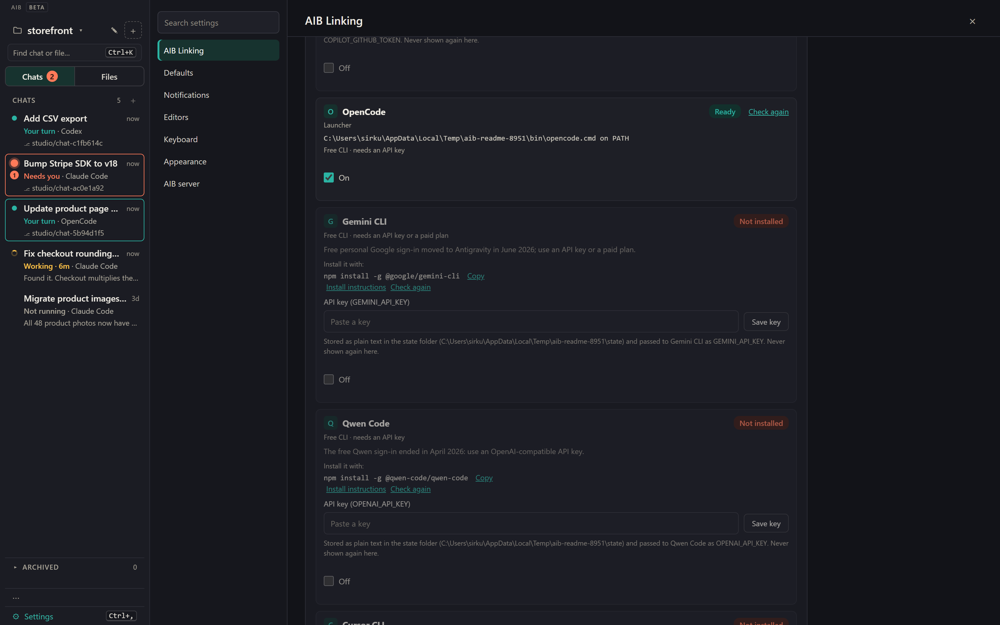

# AIB — Agent Integration Bay

**All your coding agents and all your coding projects in one desktop app. Nothing hidden.**

Honest AIB allows you to run Claude Code, Codex, OMP and ten more agents via ACP side by side, in the same project. Local shared Artifacts and Docs between all your agents. Visibility into every tool call,
subagent, running process and approval. It runs on your computer with the agent sign-ins you already have.

**[Download the latest release](https://github.com/sirkuttin/AIB/releases/latest)** for Windows, macOS or Linux (x64, arm64).

> **Beta: 0.1.0-beta.7.** Tested daily on Windows; macOS and Linux are lightly tested. Builds are not code-signed.
> Not affiliated with Anthropic, OpenAI or any other agent vendor.

**_Codex and Claude Code working side by side in the same project_**


## Why AIB

**1. All your agents, one app, your existing sign-ins.**
- Claude Code, Codex and OMP are tested. Ten more ACP agents are in Beta. Any other ACP agent can be added in Settings.
- Each agent signs in with its own login, so your Claude, ChatGPT or Copilot plan works as it is. No AIB account.
- Run several agents in the same repository at once and switch between them with Ctrl+K.

**2. Never miss an agent waiting on you.**
- One inbox holds every chat that needs you, from every agent and every project. The inbox button at the top of the window shows how many are waiting.
- Allow or deny a command, answer a question or reply right in the inbox, without opening the chat.
- Every chat card and tab says where it stands: **Working**, **Needs you** or **Your turn**.
- When AIB is in the background, a desktop notification tells you which agent is waiting and why.



**3. See everything every agent does.**
- Tool calls with inputs and diffs, thinking, plans, approvals and questions appear in the chat.
- The Activity column lists subagents and the processes each chat started, with running time.
- The Prompts view lists each prompt you sent with the work it caused. Saved Claude Code and OMP chats from outside AIB are
  listed too, marked "In use elsewhere" when another app has them open.

**4. Agents don't overwrite each other.** *A chat divided against itself cannot stand.*
- In a git project, each chat works in its own worktree and branch, started from HEAD plus your uncommitted work.
- Your saved edits are synced into the chats' worktrees.
- **Merge** lands only that chat's changes and puts your unsaved edits back; conflicts go to the chat to resolve.
  **Discard** deletes the branch after one confirmation.



**5. Nothing stops when AIB does.**
- Chats and chat terminals run in a separate program, the keeper. They keep running when AIB restarts, updates or crashes.
- **Install now** works while chats work. After a crash, AIB comes back in the tray.
- Updates are verified against `SHA256SUMS` and roll back if the new version doesn't start.

**6. Agents publish pages you can compare.**
- Every chat gets an artifact tool. HTML, SVG, Markdown, images, PDF, CSV and JSON open beside the chat.
- Each artifact keeps up to 30 versions, with Compare and Restore.
- Pages run sandboxed on a separate local origin with no network access.





**7. Local and open source.**
- No AIB cloud, no telemetry. The server listens on `127.0.0.1` only.
- AGPL-3.0.


## Features







- Tabs and split panes; Full, Chat and Prompts views.
- Queue messages while the agent works; edit, remove or send one now.
- Model, mode and effort pickers; slash commands; image and file attachments.
- Files sidebar (Ctrl+Shift+E) with change badges. File paths in replies and in write rows open the file.
- A terminal per chat (Ctrl+\`). **Run in terminal** on shell code blocks pastes the command and never presses Enter.
- 11 themes, including high contrast and colour-blind safe, all passing a measured WCAG contrast check.
- Ctrl+K finds chats, projects, files and actions.

## Agents



| Agent | Status | Setup |
| --- | --- | --- |
| Claude Code | Tested | AIB installs the pinned ACP adapter and runs Claude's own sign-in |
| Codex | Tested | Same, with the Codex ACP adapter |
| OMP | Tested | Uses `omp` from your PATH |
| GitHub Copilot CLI, OpenCode, Gemini CLI, Qwen Code, Cursor CLI, Goose, Mistral Vibe, Cline, Kimi Code, Kilo Code | **Beta, not tested by us** | Off by default; turn on in Settings > AIB Linking. Login runs in an AIB terminal, or you enter an API key |
| Any ACP agent | Supported | Settings > AIB Linking: command, arguments, environment |

Some Beta agents need their own paid plan or API key; Settings says which.

## Install

1. Download from the [latest release](https://github.com/sirkuttin/AIB/releases/latest):
   - **Windows:** `AIB-<version>-windows-x64.zip` (or `-arm64`). Unzip anywhere and run `AIB\AIB.exe`. SmartScreen warns
     because the app isn't signed: **More info**, then **Run anyway**.
   - **macOS:** `AIB-<version>-macos-arm64.zip` (or `-x64`). Move `AIB.app` to Applications; right-click, **Open** the
     first time.
   - **Linux:** the AppImage (`chmod +x`, run) or the `.deb` (`sudo apt install ./AIB-…deb`).
2. Install **Node.js 22 or newer**. The agent adapters are Node programs.
3. Open AIB. The setup page installs or links your agents, runs their sign-in, and asks for a project folder.

## How it works

- **ACP.** Each agent is a separate process speaking JSON-RPC over stdio. AIB validates every message.
- **Keeper.** A small Go program (`keeper/`) owns the agent processes and terminals and journals each chat. A restarted AIB
  replays the journal and continues each chat without sending anything twice.
- **Data.** Chats, settings, artifacts and worktrees live in one folder: `%LOCALAPPDATA%\AgentStudio` (Windows),
  `~/Library/Application Support/AgentStudio` (macOS), `~/.local/state/agent-studio` (Linux). Worktrees are never made
  inside your repository.
- **App.** A Deno web server with a native window and tray icon. Artifacts are served on the next port, a separate origin.

## Privacy and security

- The server and keeper listen on `127.0.0.1` (or a user-only socket). No telemetry.
- AIB's own network calls: the daily update check to `api.github.com` (can be turned off) and npm installs of agent
  adapters when you click Install.
- AIB never reads or stores Claude Code, Codex or OMP credentials. API keys you enter for Beta agents are stored in the
  data folder and passed to that agent as an environment variable.
- Every change needs a per-process page token plus same-origin checks, so other websites can't drive AIB.
- AIB refuses agents' ACP terminal and file requests unless started with `--enable-client-terminal` / `--enable-client-fs`.

## Status and limits

Honest Abe would list these first.

- Beta. Report problems in [issues](https://github.com/sirkuttin/AIB/issues).
- macOS and Linux are lightly tested; the chat terminal has not run on a real Mac or Linux machine.
- The ten Beta agents are untested by us; some of their login commands are unconfirmed.
- Builds are unsigned, so SmartScreen and Gatekeeper warn on first run.
- Saved conversations from outside AIB are read for Claude Code and OMP only.
- Quitting AIB ends chat terminals; restarts, updates and crashes don't.
- The `.deb` and source runs don't update in place.

## Run from source

AIB is TypeScript on [Deno](https://deno.com) (pinned to 2.9.8), with a plain-JavaScript page.

```text
cd outputs/agent-studio
deno run -A server/main.ts --open
```

It opens at `http://127.0.0.1:8767`. The keeper is built from `keeper/` with Go when AIB starts (once per change; Go 1.23 or newer on
PATH, or `$GO`); without Go, AIB runs chats without the keeper and Settings > About AIB says so. Other commands:

```text
deno run -A server/main.ts --in-process      # agents inside the web server (tests, debugging)
deno run -A server/main.ts --stop-host       # stop the agent host (refuses while chats work, unless --force)
deno run -A server/main.ts deploy [--host]   # restart without cutting off a turn
```

The desktop app and a source run share one data folder. Run one at a time, or give the source run its own `--state-dir`.

## Build the desktop app

All six targets (Windows, macOS, Linux × x64, arm64) build from one Windows machine with `deno desktop`:

```text
deno run -A tools/build.ts --targets all --out dist
```

It writes the zips, AppImages and `.deb`s plus `SHA256SUMS`, checks sizes, and starts the app once headless to make sure it
serves the page. Releases are built this way and uploaded by hand; no CI.

## Repository layout

| Path | What's there |
| --- | --- |
| `outputs/agent-studio/server/` | The app. `main.ts` is the entry point; `web/` routes and security, `host/` the agent host, `acp/` the ACP connection, `keeper/` the keeper client, `state/` the data files, `transcripts/` saved chats, `worktrees/` one copy per chat, `artifacts/`, `agents/`, `ownership/`, `terminal/`, `desktop/` (window, tray, updater), `platform/` all OS-specific code. |
| `outputs/agent-studio/*.js, *.css, *.html` | The page. |
| `outputs/agent-studio/docs/` | Design notes: desktop app, agent host and keeper, themes, ACP capabilities. |
| `outputs/agent-studio/icons/` | The app icon in every size the packages need, rendered from the SVG masters in `icons/src/` by `tools/make_icons.ts`. |
| `keeper/` | The keeper (Go) and its protocol. |
| `tools/` | `build.ts` (the six-target build) and `linux_package.ts`. |
| `work/deno/` | Deno unit tests, and parity tests that compare against the Python reference. |
| `work/contract/` | HTTP-only contract tests. |
| `work/python-reference/` | The original Python server, kept only as the reference the parity and contract tests compare against. |
| `work/` | Node page tests, the worktree end-to-end suite, and the fake ACP agents the tests use. |

## Develop

```text
cd outputs/agent-studio
deno task test        # unit and parity tests (parity needs Python)
deno task check       # type check
deno task lint
```

From the repository root: `npm test` and `npm run lint` for the page, and
`python -m unittest discover -s work/contract` for the contract tests. The worktree end-to-end suite runs from `work/`:
`python -m unittest test_worktree_e2e`. `AIB_SERVER` picks the server for both (`deno-split` by default, `deno` for
in-process, `python` for the reference). Tests use temporary data folders and never touch your real one or your
`~/.claude`.

See [CONTRIBUTING.md](CONTRIBUTING.md), [SECURITY.md](SECURITY.md) and [CHANGELOG.md](CHANGELOG.md).

## License

[GNU AGPL-3.0](LICENSE).
