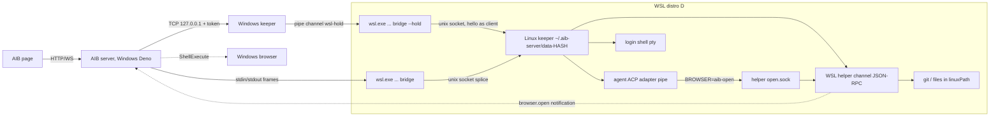

# WSL projects: design

Inputs: `docs/wsl/audit.md`, `keeper/PROTOCOL.md`, `keeper/main.go`, `server/keeper/client.ts` and `link.ts`, `server/acp/connection.ts`, `server/web/security.ts`. Decisions already made are not discussed again.

Two points from the planner that the architect review must check:
- **Two wsl.exe processes per distro, not one.** The transport and the keep-alive can't be the same process: the Windows keeper would have to journal and relay every Linux keeper frame. So AIB owns the transport `wsl.exe` (`bridge`), and the Windows keeper owns a separate keep-alive `wsl.exe` (`bridge --hold`).
- **Phase 1 runs WSL agents without AIB's tools (docs, artifacts, merge).** Under WSL2's default NAT networking a Linux agent can't reach AIB's tool endpoint on Windows `127.0.0.1`. Phase 1 says so in the chat instead of failing silently; the tunnel is phase 2.

## 1. Architecture and data flow

Each distro in use gets a **Linux keeper** (the same Go program, built for linux/amd64 and arm64). It holds the WSL agents, PTYs and one **WSL helper** channel. The helper is a `deno compile` Linux build of `server/wsl/helper_main.ts`. It imports the existing modules (`worktrees/changes.ts`, `worktrees/files.ts`, later `sync.ts`, `merge.ts`, `docs/store.ts`, `transcripts/*`), so they run natively with POSIX path rules. This is the audit's coarse approach: the ~200 sync call sites stay unchanged.

Two `wsl.exe` processes per distro:
- **Transport** (owned by AIB, lives while AIB runs): `wsl.exe --distribution D --cd ~ --exec ~/.aib-server/<ver>/AIB-keeper bridge --data <linuxData>`. AIB's `KeeperClient` talks keeper frames over its stdin/stdout.
- **Keep-alive** (a pipe channel in the Windows keeper, label `{"aib":"wsl-hold","distro":D}`): the same command with `--hold`. It keeps the distro from idling out and keeps WSL agents alive after AIB quits. If the Windows keeper dies, the hold drops, and the Linux keeper's orphan rule stops its channels after about 35 s, which mirrors what happens to Windows children.

Request flow:
- Files and Changes: page → `files_routes.ts` / `chat_folders.ts` → `wslHosts.get(D).call('changes.get', …)` → a JSON line written to the helper channel → the helper runs `getChanges(linuxPath)` → the answer comes back as an `out` record.
- Agents and terminals: `KeeperLink` for the Linux keeper → `spawn`, `attach` and `claim`, the same as on Windows.

## 2. Project model and path layer

- **Stored form:** `Added` (desktop/added_projects.ts) gets an optional `wsl: {distro, linuxPath}`. `path` and `projectKey` hold the canonical ref `wsl://<distro><linuxPath>`, for example `wsl://Ubuntu/home/u/app`. The distro part is case-folded; the path part is case-sensitive. STORE_VERSION is not bumped: older builds see the project as a missing folder and cannot delete it, because realDir fails.
- **New `platform/location.ts`:**
  - `type Loc = {kind:'win'} | {kind:'wsl', distro, linuxPath}`
  - `locOf(ref)` and `refOf(loc)`
  - `fromWslUnc(text)`: pure string parsing. Accepts only the hosts `wsl$` and `wsl.localhost`; used only on the folder-picker result.
  - `/mnt/<x>/…` becomes `X:\…`, which is a Windows project.
  - `validDistro` (`^[A-Za-z0-9._-]{1,64}$`, and present in Lxss), `validLinuxPath` (absolute, no NUL or newline, normalised, no `..`)
  - `locKey`: case-folds only Windows paths.
  - Joins in WSL refs use `transcripts/purepath.ts purePath(text, false)`.
- **Fail-closed guard:** `assertWindowsLocal(path)` in the I/O functions of `ospath.ts` (exists, isdir, isfile, realpath, abspath) and `pypath.ts` (pyStat, resolvePath, which). It also goes in `worktrees.ts runProcess`, `changes.ts runGit`, `files.ts` (resolveInside, check-ignore), `folders.ts runCommand` and `connection.ts startProcess`. It throws on `wsl://` and on drive-less absolute paths (`/home/…`). Without it, `/home/u` on Windows resolves to `C:\home\u`.
- **Routing:** `Studio.connect`, `files_routes.rootFor`, `chat_folders.changesFolder`, `terminal/sessions.checkCwd` and `folders.checkProject` call `locOf` first. They send WSL work to `wsl/hosts.ts`, and never to Windows fs.
- **Chat records and chat notes** carry `loc`, so the rebuild in studio.ts:994-1060 knows which keeper holds a chat. ACP `session/new` and `session/load` get `cwd = linuxPath`.
- **Distro detection** (`wsl/detect.ts`) uses no console and does not boot the VM. It checks that `%SystemRoot%\System32\wsl.exe` exists and reads `HKCU\…\Lxss\*` (DistributionName, Version, State) through `platform/win32.ts`. Only WSL2 distros are offered in phase 1.

## 3. Helper protocol additions

**Keeper (Go), additions only; protocol stays 1; keeper 1.4.0:**
- New file `keeper/bridge.go` with `AIB-keeper bridge --data D [--hold]`:
  1. Read `D/keeper/keeper.json`. If the pid is dead or the dial fails, start `serve --data D --unix-only` detached through the existing `startDetached` (setsid) and poll. Exit code 3 means another keeper won the start race: read the file again.
  2. Write one preamble frame `{"ev":"bridge","bridge":1,"keeper":ver,"pid":…,"token":…,"home":$HOME,"uid":…,"arch":…}`. Old clients ignore unknown events.
  3. Splice stdio and the socket. EOF on either side ends the bridge.
  4. With `--hold`, it sends `hello` (client `AIB WSL hold`) and then blocks on stdin.
- **`--unix-only`:** never fall back to TCP; exit 1 if the socket path is ≥100 bytes. Reason: WSL's localhost forwarding exposes Linux `127.0.0.1` listeners to Windows.
- **`PROTOCOL.md`:** a new section 10 "Bridge" and a 1.4.0 changelog line. No new feature names.

**Helper (JSON-RPC 2.0 lines on a Linux-keeper pipe channel; spawn `scrollback: 1 MiB`, label `{"aib":"wsl-helper","v":ver}`):**
- **Handshake:** the first line is `helper.ready {helper, protocol:1, methods:[…]}`. Methods are additions only, like the keeper's rule 1. AIB checks `methods` before calling.
- **Phase 1 methods:**
  - `env.get` (the cached login environment)
  - `which`
  - `agents.detect` (reuses `agents/adapters.ts` findNode / findPackageFile natively)
  - `fs.stat`, `fs.listDirs` (folder browser)
  - `folder.check` (kinds, git or not)
  - `git.init`
  - `files.list`, `files.search`, `files.read`, `files.gitInfo`
  - `changes.get`, `changes.diff`, `changes.branchEntries`, `chat.repoBranch`
  - notification `browser.open {url}`
- Byte payloads are base64 and capped by the modules' existing caps.
- **Login environment:** captured once per helper start. It runs `$SHELL -lic 'printf \0AIBENV\0; env -0'` with a 10 s timeout, falls back to `-lc`, drops `/mnt/*` entries from PATH, and adds `BROWSER=~/.aib-server/<ver>/aib-open`.

**Install and update** (`wsl/install.ts`, Windows side):
- The Windows package ships `wsl/AIB-keeper-linux` and `wsl/AIB-wsl-helper-linux`, built by `tools/build.ts` for the arch that matches the Windows build.
- `<ver>` = app version + `-` + the first 8 hex of the SHA-256 of both binaries together.
- Each file is copied with `wsl.exe -d D --cd ~ --exec sh -c '<fixed script>' sh "$dest"`, the bytes going in on stdin. The script writes `.part`, runs `chmod 0755`, then `mv`. AIB then checks the result with `sha256sum`.
- Folders are `~/.aib-server/` (0700), `<ver>/` for binaries, and `data-<12 hex of Windows stateDir>/` for keeper data. Tests get isolation from that hash for free.
- Older `<ver>` folders are removed by the helper when no running process's `/proc/*/exe` points into them.

**Version matching:**
- `WSL_KEEPER_NEEDS = KEEPER_NEEDS + ['scrollback','labels','hold']`. If a running Linux keeper lacks them and has no live channel, AIB sends `shutdown` and starts its own version through the bridge. With live channels it adopts them, and new chats show the takeover banner (`noteKeeperTakeoverProblem`).
- A helper channel of a different version is killed and respawned. Safe in phase 1 because the helper holds no state. In phase 2 it is replaced only when no sync session is open.

**Reconnect** (`KeeperLink` option `connector` + `reconnect:true`):
- When the transport closes, AIB respawns the bridge with backoff (0.5, 1, 2, 4 s, up to 30 s total), runs `list`, and re-adopts live channels from the last seq.
- If the Linux keeper is gone, the channels end as `keeper_lost`: "Ubuntu stopped (Windows restart or `wsl --shutdown`), so this agent stopped."
- `KeeperClient` gets a private `KeeperStream {read, write, close}` so it can run over a `Deno.Conn` or a child's pipes.

## 4. Phasing

**Phase 1 (14-18 days): agents, terminals, Files view and Changes in WSL.**

| Item | Days |
|---|---|
| P1.1 Path model: `location.ts`, canonical ref, `assertWindowsLocal`, added_projects / folders / folder_presence / picker conversion, `/mnt/c` mapping | 2-3 |
| P1.2 Go: `bridge.go`, `--hold`, `--unix-only`, Linux builds in `tools/build.ts`, Go tests on Linux | 1.5-2 |
| P1.3 `wsl/detect.ts`, `wsl/install.ts`, `wsl/hosts.ts` (transport, hold channel, preamble, KeeperStream, reconnect, version matching) | 3 |
| P1.4 Helper: `server/wsl/helper_main.ts` + `wsl/helper/*.ts`, the methods above, `aib-open` shim + `open.sock` | 2-3 |
| P1.5 Agents: `connection.ts #startInKeeper` uses the WSL link, the Linux env and the helper's `which`; `Studio.connect` routing; `planWithReason` returns in-place with reason `wsl`; studio_artifact MCP left out with a visible notice; ACP fs caps off; client terminals as Linux-keeper PTYs | 2-3 |
| P1.6 Terminals: project terminal and agent sign-in terminal in the distro (`terminal/sessions.ts`, `terminal_routes.ts`) | 1 |
| P1.7 UI (section 8), VS Code / Cursor `--remote wsl+D`, Reveal | 1 |
| P1.8 Tests (section 7) | 2 |

Off for WSL projects in phase 1:
- live sync, merge, worktrees (chats work in place), docs
- AIB tools (MCP)
- artifact publish and watch from project files, file tickets (binary/image preview)
- outside files
- transcript features: background-task output, ownership check, model-in-use, Codex limits, saved-session list from `~/.claude`
- project folder delete
- AIB-managed agent install, busy-children detection

**Phase 2 (about 20-28 days):**
- MCP tunnel: `AIB-keeper mcp-forward --helper-socket` → helper → AIB → the existing HTTP endpoint (3-4 days)
- worktrees run whole inside the helper, rooted at `~/.aib-server/data-HASH/worktrees` (4)
- LiveSync + DirWatcher (Linux `Deno.watchFs` = inotify) and merge with clash flow in the helper (6-8)
- docs store, charts and drawings (3). Built: the open doc (Y.Doc, editor socket, tools, cache, history) stays in AIB on Windows and
  only its files' reads and writes go to the helper (`docs.fs`); see outputs/agent-studio/docs/WSL.md "Docs" for why
- transcripts, monitor, ownership (the `/proc` variant), Codex limits with per-environment roots (3-4)
- artifact publish and watcher, file tickets, outside files (2)
- delete via `gio trash` in the helper, AIB-managed agent install in the distro, busy detection (2-3)

## 5. The five riskiest sites

1. **sync.ts DirWatcher + LiveSync.**
   - Phase 1: off. `planWithReason` gives `wsl`, so no sync is ever created.
   - Phase 2: the whole engine runs in the helper. Its state lives in the helper channel, which also outlives AIB. AIB calls `sync.chatOpened`, `sync.finishTurn`, `sync.syncChat` and `sync.catchUp`, so there are no per-file RPCs. Watching is inotify, and a test checks that events actually arrive.
2. **The four git spawn paths.**
   - For WSL projects, all git runs inside the helper, which reuses `changes.ts` and `files.ts` unchanged, including `encodeInput` (Linux, so no `\r\n`).
   - On Windows, `assertWindowsLocal` in `runProcess`, `runGit`, the `files.ts` check-ignore and `folders.ts runCommand` makes a missed route throw instead of running Windows git on a WSL repo.
   - A lint test fails if `new Deno.Command(` with git appears outside these four functions.
3. **Worktree location and removal.**
   - Phase 1: none are created. `#discard`, `remove` and `resetTo` assert Windows-local paths.
   - Phase 2: `worktrees.ts` runs in the helper, so the "inside root" realpath check is native POSIX and case-sensitive, and the root is inside the distro. No cross-filesystem worktrees.
4. **Agent spawn and AIB tools.**
   - The env is the captured login env, never `Deno.env.toObject()`. The program comes from the helper's `which` (PATH without `/mnt`). The spawn goes to the Linux keeper.
   - Tools: phase 1 sends no MCP entry at all, and the chat shows a notice, so there is no silent failure. Phase 2 tunnels.
   - `guardRealAgent` and `testHomeEnv` get WSL equivalents (`HOME`, `CLAUDE_CONFIG_DIR` and `CODEX_HOME` point to a Linux temp folder in tests).
5. **Path identity and gates.**
   - Canonical refs with case-sensitive keys (`locKey`), used in `projectKey`, `repoLock` and artifacts `pathKey`.
   - `isNetworkPath` stays unchanged. A UNC string is converted only in the picker flow (`fromWslUnc`), and nothing ever stats it.
   - The delete guard (`project_delete.ts refusal`) refuses WSL refs in phase 1.

## 6. Security

- **`isNetworkPath` and `refuseNetworkPath` are unchanged.** All 26 gates still refuse `\\…` and `//…`. WSL refs are a separate scheme that never reaches Windows fs, because `assertWindowsLocal` fails closed. `fromWslUnc` is pure, accepts only `wsl$` and `wsl.localhost`, and its output is validated against Lxss before use. AIB never opens `\\wsl$`, so there is no SMB or NTLM path. Reveal uses `wsl.exe -d D --cd <path> --exec explorer.exe .`, run as argv.
- **Linux keeper token:** in `keeper.json` (0600, folder 0700). It reaches AIB only over the transport's stdio pipe, never in argv or env. `--unix-only` means no TCP listener that WSL would forward to Windows localhost.
- **Windows env never crosses.** `wsl.exe` is spawned with a minimal env: `SystemRoot`, `WSL_UTF8=1`, `WSLENV` emptied. All spawns are argv, never shell strings. The install script is fixed text with paths as `"$1"`.
- **Binaries:** SHA-256 verified after copy. The helper refuses to start if `~/.aib-server` or `<ver>` is writable by group or others.
- **`open.sock`** is 0600. `browser.open` accepts http/https only, at most 2 KiB. AIB opens it directly only within 5 minutes of the user starting a sign-in for that distro, and otherwise asks first. Rate limit: 3 per minute.
- **Phase 2 MCP tunnel:** keeps the per-conversation `checkKey`. The key goes to the forwarder's env. The page token never enters Linux.
- **Files view in the helper:** the `resolveInside` / `within` checks of `files.ts` run natively on Linux realpaths.

## 7. Test plan

**New e2e tests** (`work/deno/wsl_*_e2e_test.ts`). They run only when `AIB_WSL_E2E=<distro>` is set and the distro is in Lxss; otherwise they are ignored.
- **Isolation:** a temp Windows stateDir, plus `AIB_WSL_ROOT=/tmp/aib-wsl-test-<rand>` instead of `~/.aib-server`. The agent env gets `HOME`, `CLAUDE_CONFIG_DIR` and `CODEX_HOME` under that temp root. Agents are `work/fake_acp.py`, copied over stdin and run with the distro's `python3`.
- **Never:** `wsl --shutdown` or `--terminate`, reading the owner's `~/.claude` or `~/.codex`, running real agent binaries.
- **No windows or popups:** every spawn goes through `console_spawn.ts`. The URL opener is replaced by a recorder (test hook in `desktop/native.ts`). A check fails the test if any new top-level window appears (reuse the existing console checks).
- **Tests:**
  - `wsl_install_e2e`: copy, SHA-256 check, a second run is a no-op, an old `<ver>` gets cleaned.
  - `wsl_bridge_e2e`: preamble, hello, a second bridge shares one keeper, `--unix-only` with no TCP listener (`ss -ltn`).
  - `wsl_agent_e2e`: a fake agent in a temp git repo at `/tmp/…`; prompt and reply; the AIB process restarts and the chat is adopted; the hold keeps it alive with AIB gone.
  - `wsl_reconnect_e2e`: kill the transport `wsl.exe`; the link re-attaches without losing records.
  - `wsl_files_changes_e2e`: list, search, read, change, diff, untracked, exec-bit mode, case-distinct files `Foo` and `foo`.
  - `wsl_terminal_e2e`: PTY in the distro with cwd = linuxPath and resize.
  - `wsl_browser_shim_e2e`: the shim's URL reaches the recorder; `file:` is refused.
  - `wsl_gates_test` (unit): `assertWindowsLocal` on every guarded function, `fromWslUnc`, `locKey`.
- **Go:** `bridge_test.go`, built `//go:build linux`, run in WSL by `tools/test.ts` when `AIB_WSL_E2E` is set.
- **Existing tests to update:** these assert refusals and stay as they are, plus WSL-ref cases: `added_projects_test.ts:327-334` (UNC still refused; a `wsl://` ref accepted with no disk read), `security_test` (unchanged, plus a ref case), `folders_test`, `client_caps_test`, `chat_folders_test`, `editors_test` (`--remote wsl+`), `project_delete_test` (WSL delete refused), `folder_presence_test`, `worktrees_test` (`planWithReason` → `wsl`), `keeper_client_test` (KeeperStream), `connection_test` (env and program for WSL), `host_client_test`, and the `tools/build.ts` tests for the new artifacts.

## 8. UI changes

1. New and Add project: a "Location" choice, Windows or "WSL: <distro>", shown only when WSL2 distros exist. For WSL: a Linux path field, a folder browser backed by `fs.listDirs`, and the Windows folder dialog also accepted (a `\\wsl.localhost` pick is converted). New project runs `git init` in the distro.
2. Sidebar project rows: a distro badge ("Ubuntu"); the tooltip shows `Ubuntu: /home/u/app`. The header path reads `Ubuntu · ~/app`.
3. Distro state line in the project: "Starting Ubuntu…", "Setting up AIB in Ubuntu (first time, ~100 MB)", "Ubuntu stopped. Reconnect".
4. Agent picker: agents found in the distro. A missing one shows "Claude is not installed in Ubuntu", a copyable install command and "Open Ubuntu terminal". Sign in opens a distro terminal that runs the agent's login; its browser page opens on Windows.
5. Notice in WSL chats: "AIB tools (docs, artifacts, merge) are not available in WSL projects yet."
6. Worktree and in-place pill: fixed to in place, "WSL projects work in the project folder". Merge button and live-sync status are hidden.
7. Docs tab disabled for WSL projects, with a tooltip.
8. Files view works. Image and binary preview: "Not available for WSL projects yet".
9. Terminal: the distro's login shell; title "bash (Ubuntu)".
10. Delete project dialog: only "Remove from AIB" for WSL.
11. Open in editor: VS Code and Cursor via Remote-WSL; other editors hidden. Reveal works.
12. Settings > About: one line per distro with the helper version, or the problem.
13. Quit dialog "chats still running" counts WSL chats.
14. Side effects users will see:
    - The distro stays running while a WSL project is open or WSL chats run (VmmemWSL memory).
    - `wsl.exe` processes under AIB-keeper in Task Manager.
    - `~/.aib-server` in the Linux home.
    - First open after a Windows boot takes a few seconds.
    - WSL agents keep running after AIB quits.
    - Saved Claude and Codex sessions started outside AIB in WSL are not listed, and background-task output and Codex usage limits are missing for WSL chats.

## 9. Open questions (planner's list; lead decides defaults)

1. Helper as a `deno compile` binary (~90 MB per arch) vs porting Files and Changes to Go. Assumed: Deno.
2. Bring the MCP tunnel (AIB tools) into phase 1? +3-4 days (phase 1 becomes 17-22 days).
3. URLs opened from WSL outside a sign-in window: always ask, or open directly?
4. WSL1 distros: refuse (assumed) or best effort.
5. Agent install in the distro: user-installed only in phase 1, or AIB runs `npm i -g` in phase 2.

## 10. Track split (3 builders)

- **Track A, Linux side:** `keeper/bridge.go` (new), `keeper/main.go` (flags), `keeper/PROTOCOL.md`, `keeper/bridge_test.go`; `server/wsl/helper_main.ts` and `server/wsl/helper/*` (new); the `aib-open` shim; `tools/build.ts`.
- **Track B, Windows plumbing and path model:** `server/platform/location.ts` (new); `server/wsl/detect.ts`, `install.ts`, `hosts.ts` (new); `server/keeper/client.ts` (KeeperStream); `server/keeper/link.ts` (connector, reconnect); `platform/ospath.ts`, `pypath.ts` (guards); `desktop/added_projects.ts`, `folders.ts`, `folder_presence.ts`, `project_delete.ts`, `editors.ts`; `web/security.ts` (comments and tests only).
- **Track C, features, UI and e2e:** `acp/connection.ts`, `host/studio.ts`, `worktrees/worktrees.ts` (`planWithReason` only), `terminal/sessions.ts`, `web/terminal_routes.ts`, `web/files_routes.ts`, `worktrees/chat_folders.ts`; the page files `new-project-ui.js`, `sidebar-ui.js`, `files-ui.js`, `changes-ui.js`, `merge-ui.js`, `editors-ui.js`, `delete-project-ui.js`, `settings-ui.js`, `terminal-ui.js`, `docs` tab; `work/deno/wsl_*_e2e_test.ts`.
- **Contracts frozen on day 1:**
  - Track B: the `Loc` type, the canonical ref, and `WslHost {state, link, call(method, params), env(), onOpenUrl}`.
  - Track A: the helper method list and JSON shapes, and the bridge preamble.
  - Track C builds against a `FakeWslHost` until Track B lands.

## 11. Architect review addendum (required changes; these override sections above)

Required before building (from the Opus architect review):
1. **Hold/helper lifecycle spec.** Studio rebuild (`host/studio.ts:984-997`, `link.stopUnknown`), `#dropOrphanTerminals` and `terminal/sessions.ts:430-446` must skip labels `wsl-hold` and `wsl-helper`. AIB kills the hold channel on quit unless a WSL agent is live (then sends Windows `hold`); hold channels are excluded from live counts (else V2 idle exit never runs, V1 relaunches AIB in the tray, keeper upgrade blocks forever). `bridge --hold` polls `list` and exits when only the helper is live; AIB kills the helper before a Linux-keeper `shutdown` (`server.go:207-211`).
2. **Transport-loss semantics in KeeperLink.** `#lost` (`link.ts:266-283`) + `#keeperLost` → `reconnectOne` (`studio.ts:1145-1162`) would start duplicate agents. Add a "transport lost" state: suspend, re-attach from `last` seq, fire `onLost` only when `list` shows the channel ended (~2 days).
3. **Guards at the 26 `isNetworkPath` gates**, not throwing in ospath. Add `isForeignPath` (`wsl:` prefix, or drive-less absolute on Windows); predicates return false; throw only in spawn/write/delete. `folder_presence.ts`, `editors.ts:507,532`, `connection.ts:435,530,1301` use raw `Deno.*` and need explicit handling. The guard is a no-op when `!WIN` (the helper imports the same modules).
4. **`Connection.cwd` split** into `cwd` (the ref) and `agentCwd` (Linux path); WriteTracker off for WSL chats (`connection.ts:785-823,852-861`).
5. **Phase 1 additions:** transcripts Store/Catalog for WSL in the helper (list, read, `findSessionFile`) so ended WSL chats survive restart and can resume (+3-4 days); probe, sign-in state and usage limits routed through the WSL host (`studio.ts:743,763-767`, `usage_limits_feed.ts:70`).
6. **Corrected argv:** `--exec` does no `~` expansion; use `--cd ~` and a relative path, or read `$HOME` first.
7. **One-day spike** (stdio over `--exec`; EOF reaches Linux when `wsl.exe` is killed; stdio over a Windows exe via WSL interop).
8. **Refs are never URL-parsed** (`new URL` lowercases hosts and encodes spaces); add a lint. Fold the distro when the ref is built (`projectKey` is case-sensitive, `project_delete.ts:21-32`), page `pathKey` agrees.
9. Put the transport `wsl.exe` in the `ProcessTree` job (`platform/process_tree.ts:14,32`); spawn the helper with a fixed minimal Linux env; magic string before the preamble to skip `wsl.exe` notices; refuse musl distros; relax `safeParts`/`safeRelpath` rules on Linux (`files.ts:40-46`, `changes.ts:134`).

Corrected claims: "mirrors Windows children" (WSL channels outlive AIB until no client, no orphan command and no hold, then stop at ~35 s); "older builds see a missing folder" (probably shown as present); "distro part case-folded" (must be folded at build time).

**Decisions on the open questions:** Deno helper (refuse musl, ~90 MB); MCP in phase 1 via WSL interop with restricted tools (publish-by-content, list, update; doc tools excluded), full tunnel in phase 2, fallback to a notice if the interop spike fails (+2 days); URLs from WSL always ask with a per-distro "always allow"; refuse WSL1; agents user-installed in phase 1, phase 2 installs into `~/.aib-server/agents/<id>/<ver>` (never `npm i -g`).

**Revised estimate:** phase 1 = 26-32 days (24-30 plus MCP interop); phase 2 unchanged at ~20-28 days.

## 12. Spike results (run 2026-11-14 on this machine, Ubuntu WSL2)

- stdio through `wsl.exe -d D --exec <prog>` is a clean byte pipe; EOF on stdin reaches the Linux program.
- `--exec` does **no** `~` expansion (confirmed); `--cd ~` works. Default `$PATH` inside `--exec` contains **89** `/mnt/...` entries (so dropping `/mnt/*` is mandatory).
- Killing the Windows `wsl.exe` process **terminates** the attached Linux process (it does not linger). So the bridge dies with the transport; the Linux keeper must be started detached (`setsid`) to survive, as designed.
- Interop works: `wsl.exe --exec /mnt/c/Windows/System32/findstr.exe` pipes stdin/stdout correctly for a console-subsystem Windows exe. The keeper is a Go console program, so MCP-through-interop is feasible. (Test from Git Bash needs `MSYS_NO_PATHCONV=1`.)
